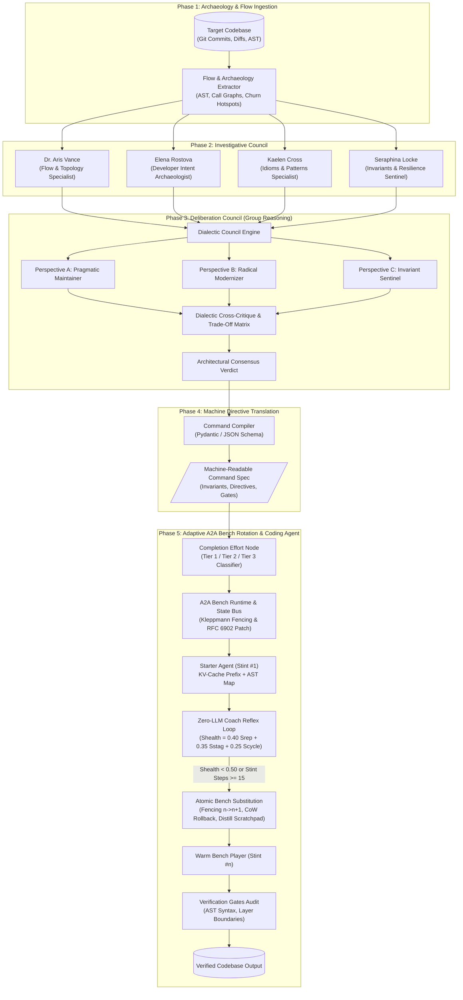

# FlowMind: Multi-Agent Software Architecture Research & Deliberation Engine

An autonomous multi-agent cognitive architecture system that scans repositories, investigates the **"Flow" of Software Architecture** and the **thought processes of developers**, deliberates via a **multi-perspective group reasoning council**, synthesizes findings into **strictly typed machine-readable directives**, and executes them with an **autonomous Reasoning Coding Agent**.

---

## Architecture Overview



---

## Key Features

1. **Repository Archaeology & Cognitive Ingestion**:
   - Mines Git commit genealogies, intent tags (`HACK`, `WORKAROUND`, `BUG_FIX`, `REFACTOR`), and churn hotspots.
   - Parses ASTs across Python modules and builds directed call & dependency graphs using NetworkX.
2. **Specialized Investigative Personas**:
   - **Dr. Aris Vance**: Analyzes component topology, fan-in/fan-out, dataflow pipelines, and synchronous bottlenecks.
   - **Elena Rostova**: Reconstructs developer mental models, evolutionary pivots, and cognitive compromises.
   - **Kaelen Cross**: Identifies architectural design patterns, god-classes, and structural drift.
   - **Seraphina Locke**: Enforces hard domain invariants, detects concurrency hazards and layer boundary leaks.
3. **Dialectic Group Deliberation Council**:
   - **Round 1 (Divergent Theses)**: Pragmatist vs. Modernizer vs. Sentinel present competing stances.
   - **Round 2 (Dialectic Cross-Critique)**: Direct cross-examination addressing blast radius, technical debt, and state integrity.
   - **Round 3 (Synthesis & Trade-off Matrix)**: Multi-criteria quantitative scoring across Architectural Coherence, Invariant Safety, Blast Radius, Ergonomics, and Feasibility.
4. **Machine-Readable Command Translator**:
   - Emits schema-validated JSON task specs with hard architectural invariants, ordered execution directives, and verification gates.
5. **Coding Agent with Independent Reasoning Engine**:
   - Implements a dedicated multi-phase reasoning model:
     - **Pre-flight Invariant Audit**
     - **Chain-of-Thought (CoT) AST Context Planning**
     - **Code Synthesis**
     - **Post-Mutation AST & Invariant Self-Audit**

6. **Adaptive Agent-to-Agent (A2A) Bench Rotation & State Bus Runtime**:
   - **Completion Effort Node (Execution Tiers)**:
     - **Tier 1 (Direct Execution)**: Est. steps <= 5, static state, max_turns = 5 circuit breaker.
     - **Tier 2 (Managed Single Agent)**: Est. steps 6--15, 5m cache TTL, local stdout truncation.
     - **Tier 3 (Full A2A Bench Rotation)**: Est. steps > 15, high mutability, 1h cache TTL, warm roster substitutions.
     - **Mid-Game Promotion Rule**: Automatically promotes Tier 2 -> Tier 3 if steps >= 8 without completion, stdout >= 12,000 tokens, or 2 consecutive failures.
   - **Prompt Prefix Ordering (Zero-Latency KV-Cache Handoff)**:
     - Strict 4-layer prefix hierarchy: `1. System Instructions` -> `2. AST Repomap (2,048 tokens)` -> `3. Shared State Bus Ledger` -> `<-- [1-HOUR CACHE BREAKPOINT]` -> `4. Private Agent Scratchpad`.
   - **Asymmetric State Bus (NATS KV + RFC 6902 + Kleppmann Fencing)**:
     - Enforces monotonic Kleppmann fencing tokens (`fencing_token >= max_accepted_token`).
     - Applies RFC 6902 JSON Patches for 5-step timeout syncs and substitution updates.
     - Firecracker-style CoW snapshotting and rollback on failed stints (~28ms).
   - **Zero-LLM Coach Telemetry & Reflex Loop**:
     - Fast deterministic reflex loop (0 LLM tokens): $S_{health} = 0.40(S_{rep}) + 0.35(S_{stag}) + 0.25(S_{cycle})$.
     - Triggers warm bench substitution if $S_{health} < 0.50$ or $stint\_steps \ge 15$.
     - Executes 4-step Atomic Substitution Checklist: increment fencing token, CoW snapshot rollback, scratchpad distillation into RFC 6902 patch, dispatch bench player.

7. **Client-Facing Interactive Web Cockpit & HTML Reports**:
   - **SPA Web Dashboard (`http://localhost:8000/dashboard`)**: Interactive cockpit to launch audits, track active A2A stints in real-time, inspect the Cognitive Brain, and run the New Developer Aid suite.
   - **Executive HTML Audit Report (`--report-html audit.html`)**: Tabbed zero-dependency report with interactive Mermaid component flow DAGs, quantitative trade-off matrices, unified code diffs, and printable PDF styling (`@media print`).
   - **Automated GitHub PR Scorecards**: Posts non-blocking markdown scorecards and verification gate checklists directly to pull requests.

8. **New Developer's Aid & "What We Learned" Retrospectives**:
   - **Code Explainer**: Translates complex files into plain-English summaries, responsibilities, and beginner usage examples.
   - **Error Diagnostician**: Parses stack traces to pinpoint root causes, anti-patterns (e.g. mutable defaults, bare excepts), and step-by-step remediation plans.
   - **Session Retrospectives**: Automatically generates executive takeaways, developer mental models, and ruled-out dead ends at the close of every investigation.

9. **Cognitive Brain & Contributor Attribution Lineage**:
   - Tracks model evolution stages across generations (`ModelEvolutionStage`).
   - Accredits every learned skill, codified invariant, and heuristic directly to the repository author/owner.
   - Injects accredited capability lineage directly into LLM reasoning prompts.

10. **Multi-Carrier LLM Support (including Google Gemma 3B)**:
    - Native support for **Google Gemma 3B** (local via Ollama / vLLM / SGLang or cloud via Google AI Studio).
    - First-class carriers for Anthropic Claude 3.5, OpenAI GPT-4o, and Google Gemini 1.5.

---

## Directory Structure

```
RepoRewards/
├── repo_investigator/
│   ├── models/            # Pydantic schemas (Archaeology, Deliberation, Command Specs, State Bus)
│   ├── bench_rotation/    # A2A Bench Rotation runtime (Tiers, State Bus, Coach Telemetry, Prompt Cache)
│   ├── a2a/               # Module alias re-exporting bench_rotation
│   ├── memory/            # Module alias re-exporting bench_rotation state bus
│   ├── extractor/         # Git archaeology miner & AST flow topology analyzer
│   ├── investigators/     # Specialized investigative agent team
│   ├── deliberation/      # Deliberation council & multi-criteria scoring matrix
│   ├── translator/        # Command compiler producing machine-readable JSON specs
│   ├── coding_agent/      # Reasoning Coding Agent with independent reasoning model & A2A integration
│   ├── llm/               # Pluggable reasoning LLM engine & deterministic cognitive engine
│   ├── orchestrator.py    # Master pipeline runner
│   └── cli.py             # Rich interactive command-line interface
├── sample_repo/           # Realistic sample repo with historical commits & architectural debt
├── tests/                 # Full unit and integration test suite (pytest)
├── main.py                # CLI entry point
├── Dockerfile             # Multi-stage production container build
├── docker-compose.yml     # Distributed production stack (FlowMind, Redis, NATS, Jaeger)
└── pyproject.toml         # Package metadata, optional extras & dependencies
```

---

## Production Deployment & Stack Orchestration

### 1. Launch Distributed Production Stack (Docker Compose)
Spins up FlowMind with **Redis** (atomic CAS state bus), **NATS JetStream** (message broker), and **Jaeger** (OpenTelemetry distributed tracing):
```bash
docker compose up --build
```

### 2. Environment Variables & Production Settings
Configure production infrastructure via environment variables:
```bash
# Distributed State Bus Backend
export FLOWMIND_STATE_BUS_BACKEND=redis      # "in_memory", "redis", "nats"
export FLOWMIND_REDIS_URL="redis://localhost:6379/0"
export FLOWMIND_NATS_URL="nats://localhost:4222"

# Sandbox Isolation Engine
export FLOWMIND_SANDBOX_PROVIDER=local       # "local", "docker", "firecracker_vsock"
export FLOWMIND_DOCKER_IMAGE="python:3.12-slim"
export FLOWMIND_VSOCK_PORT=1024

# Model Carrier & 1-Hour KV-Cache Breakpoints
export FLOWMIND_MODEL_PROVIDER=anthropic     # "anthropic", "openai", "sglang", "gemini"
export ANTHROPIC_API_KEY="sk-ant-..."
export SGLANG_ENDPOINT="http://localhost:30000/v1"

# OpenTelemetry Distributed Tracing
export FLOWMIND_TELEMETRY_SINK=opentelemetry # "local", "opentelemetry", "prometheus"
export OTEL_EXPORTER_OTLP_ENDPOINT="http://localhost:4317"
```

---

## Quickstart & CLI Usage

### 1. Launch the Client-Facing Web Dashboard
Spins up the REST API and launches the interactive client cockpit:
```bash
flowmind serve
# Open http://localhost:8000/dashboard in your browser
```

### 2. Generate Interactive Client-Facing HTML Audit Report
```bash
flowmind sample_repo --dry-run --report-html client_audit.html
```

### 3. Run Investigation with Google Gemma 3B Carrier
```bash
flowmind sample_repo --model-provider gemma --dry-run
```

### 4. New Developer's Aid (Coach, Debugger & Guidance)
```bash
# Explain a file's responsibilities and gotchas in plain English
flowmind --explain sample_repo/rewards_processor.py

# Diagnose a Python error or traceback and receive step-by-step fix
flowmind --debug "AttributeError: 'NoneType' object has no attribute 'execute'"

# Get architectural guidance for a new feature
flowmind --guide "Add Redis distributed caching to rewards calculation"
```

### 5. Inspect Cognitive Brain & Model Evolution Lineage
```bash
flowmind brain
```

### 6. GitHub REST API Engine (Compliant with Official GitHub REST Guides)
Comprehensive client suite adhering strictly to [GitHub REST API Guides](https://docs.github.com/en/rest/guides):
```bash
# 1. Inspect real-time GitHub rate limits and quota status
flowmind github status

# 2. Create a new GitHub repository, attach remote origin, and push main branch
flowmind github create-repo MyNewRepo --private --set-remote --push

# 3. Post / update architectural scorecard comment on Pull Request
flowmind github post-comment --repo owner/repo --pr 42

# 4. Post CI Commit Status on a specific commit
flowmind github commit-status --repo owner/repo --sha abc1234 --state success

# 5. Create a GitHub Check Run with structured evaluation
flowmind github check-run --repo owner/repo --sha abc1234 --conclusion success

# 6. Verify incoming webhook HMAC-SHA256 signature
flowmind github verify-webhook --secret "mysecret" --signature "sha256=..." --payload "payload.json"
```

### 7. Run the Test Suite
```bash
python -m pytest -v
```

---

## Example Machine-Readable Output Directive

```json
{
  "task_id": "TASK-VERDICT-SAMPLE_REPO-001",
  "title": "Architectural Refactoring Spec: Targeted Invariant-Guarded Decoupling Strategy",
  "architectural_invariants": [
    {
      "id": "INV-001",
      "rule": "Domain entities must not directly import or invoke database / storage adapters.",
      "invariant_type": "IMPORT_RESTRICTION",
      "enforcement_scope": "core.*",
      "verification_heuristic": "Check AST imports of core modules for storage/db dependencies."
    }
  ],
  "execution_directives": [
    {
      "step_number": 1,
      "action_type": "CREATE_FILE",
      "target_file": "core/interfaces.py",
      "target_symbol": "ExecutionProtocol",
      "instruction": "Define a clean abstraction protocol 'ExecutionProtocol' with standard execute() method.",
      "preconditions": ["Repository path exists"],
      "postconditions": ["File 'core/interfaces.py' exists and exports ExecutionProtocol"],
      "diff_strategy": "NEW_MODULE"
    }
  ],
  "verification_gates": [
    {
      "gate_id": "GATE-01",
      "gate_name": "AST Syntax & Symbol Audit",
      "gate_type": "AST_SYNTAX_CHECK",
      "target": "all_mutated_files",
      "criteria": "All modified and newly created files must compile to valid Python AST without syntax errors."
    }
  ]
}
```
